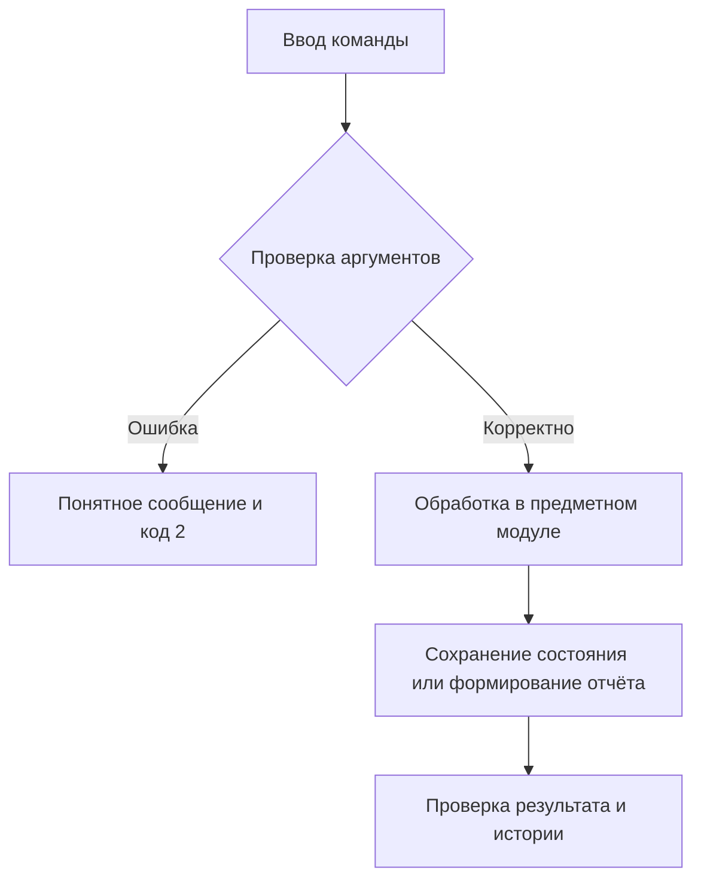

# Отчёт. Практическая работа №19–20

## Задание 5. Складская система с CI

Дата: 5 ноября 2026 года.

## Цель

Разработать работающее приложение по заданию 5, проверить корректность,
организовать версионность и документировать применённые практики управления конфигурацией.

## Архитектура

SQLite products и operations; изменение остатка и запись операции выполняются одной транзакцией. Удаление логическое, журнал сохраняется.

Стек: Python 3.11/3.12, стандартная библиотека, pytest 8.3.5, ruff 0.11.13;
сборщик hatchling 1.27.0. Зависимости фиксируются в pyproject.toml и uv.lock.
Консольный интерфейс — src/inventory/cli.py, логика — src/inventory/core.py,
тесты — tests/. Платформа задания 8 отдельно определяет схему в storage.py.

## Схема алгоритма

Товар → поступление/списание → проверка stock + delta ≥ 0 → транзакция → журнал → отчёт.



## Основной фрагмент реализации

Код из src/inventory/core.py, функция move:

```python
    def move(self, sku, quantity, kind, note=""):
        if type(quantity) is not int or quantity <= 0:
            raise ValueError("Количество должно быть положительным целым")
        if kind not in ("receipt", "writeoff"):
            raise ValueError("Неизвестный тип операции")
        delta = quantity if kind == "receipt" else -quantity
        with self.db:
            cur = self.db.execute(
                "UPDATE products SET stock=stock+? WHERE sku=? AND active=1 AND stock+?>=0",
                (delta, sku, delta),
            )
            if cur.rowcount != 1:
                self.get(sku)
                raise ValueError("Недостаточный остаток")
            self.db.execute(
                "INSERT INTO operations(sku,delta,created_at,note) VALUES(?,?,?,?)",
                (sku, delta, datetime.now(timezone.utc).isoformat(), note),
            )
        return self.get(sku)
```

Полный исходный код находится рядом с отчётом. Для защиты работы следует разобрать
его самостоятельно; происхождение реализации не представляется как подтверждение
самостоятельного написания студентом.

## Запуск и полученные результаты

Команда демонстрации: `uv run python examples/demo.py` в отдельно клонированном проекте;
в общем workspace: `uv run --all-packages python inventory/examples/demo.py` из корня.

```text
Остаток: 7 ; запрет: Недостаточный остаток
```

Основное свидетельство: [examples/stock.json](examples/stock.json).
Локальные тесты: **15 passed in 0.02s**. Ruff и справка CLI: успешно.
Полный протокол: [examples/verification.txt](examples/verification.txt).
Общий набор: **94 тестов пройдены на Python 3.12.14 и Python 3.11.16**.
Эти протоколы получены локально и не выдаются за GitHub Actions.

## Git и прослеживаемость

Каждый каталог — отдельный настоящий Git-репозиторий. История создавалась по этапам:
настройка пакета → функции → CLI → тесты → документация → демонстрации и проверка.
Функциональные ветки сохраняются после локального слияния; дата коммитов не подменялась.
Тег v1.0.0 фиксирует завершённое локальное состояние.

```text
ci-failure-demo
ci-failure-example
feature-core
main
```

Проверка: `git log --graph --oneline --all`, `git branch`, `git tag`, `git show v1.0.0`.
Подробные снимки всех репозиториев собраны в ../git-evidence.json.

Намеренная регрессия и исправление зафиксированы разными коммитами; логи до/после
в examples/intentional-failure.txt и after-fix.txt. Ветка ci-failure-example
сохранена на ошибочном коммите. Main содержит исправление.

## Недостающие внешние свидетельства

Workflow YAML подготовлен. Репозиторий не опубликован, URL реальных запусков
GitHub Actions пока нет. Для сдачи нужны ссылки или скриншоты, перечисленные
в CI_EVIDENCE.md. Публикация требует отдельного разрешения пользователя.

## Ограничения и вывод

Количество целое, поиск чувствителен к регистру; стоимость, партии и многопользовательские роли не предусмотрены.

Приложение выполняет локальные функциональные требования и имеет автоматизированные
проверки. Реализованные практики SCM и организационные правила описаны в SCMP.md.
Использование отдельных принципов ISO/IEC/IEEE 828:2012 не доказывает полного
соответствия стандарту. GitHub-подтверждения, где они требуются, остаются отдельным
внешним этапом до окончательной сдачи.
